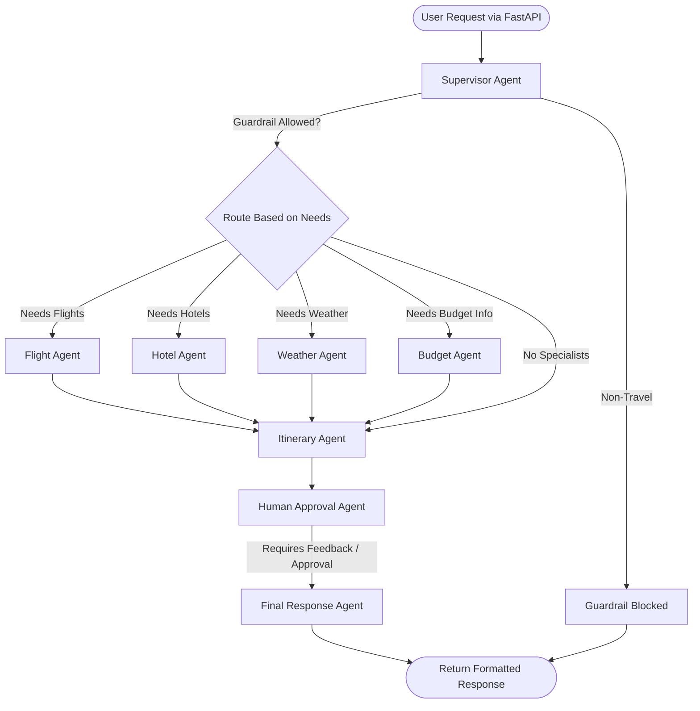

# System Architecture

Journeo utilizes a Multi-Agent architecture built with **LangGraph**. It combines synchronous graph processing with modern conversational memory retention backed by **PostgreSQL**.

## High-Level Workflow

Below is the execution flow detailing how a request is processed from the moment it hits the API endpoints to the final LLM compilation.

## Components

### 1. FastAPI Frontend (`app.py`)
Responsible for exposing asynchronous endpoints (`/api/travel`, `/api/travel/approve`, `/health`). Uses `nest_asyncio` to allow the underlying synchronous `invoke()` calls of LangGraph to run within the Uvicorn execution loop without conflicting.

### 2. The LangGraph Engine (`backend.py`)
Handles conversational threading, multi-turn states, and AI agent routing.
- **PostgreSQL Checkpointer**: Every graph invocation maps to a `thread_id` (usually passed from the frontend). Memory is saved in PostgreSQL allowing session resumption and distributed load-balancing without data loss.
- **Dynamic Routing**: The supervisor dynamically skips steps. If the user only asks for hotels, the flight, weather, and budget agents will be bypassed.

### 3. Model Context Protocol Entities (`mcp_client.py`)
Agents don't have hardcoded function calls. Instead they dispatch intent to MCP clients (managed by `langchain-mcp-adapters`).
* **Tavily MCP**: HTTP streamable connection to Tavily servers. Used by the Hotel Agent.
* **AviationStack MCP**: Stdio-based subprocess execution spawned via Astral's `uvx`. Used for listing airlines and airports.
* **Weather MCP**: Stdio Python script execution utilizing the local `custom_weather_mcp_server.py`. Extracts destination inputs dynamically and queries OpenWeather.
